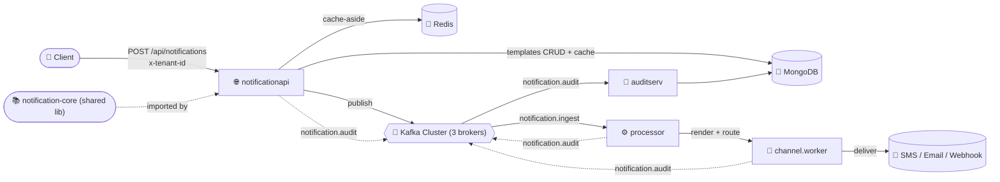

# 🔔 Notification Platform

A multi-tenant, event-driven **notification platform** built as a set of independent Spring Boot microservices. Clients submit a notification request once; the platform resolves the message template, fans it out through Kafka, dispatches it across multiple channels (SMS / Email / Webhook), and keeps a full audit trail — all isolated per tenant.

> 📦 This is a Maven **multi-module** repository. Each service below is independently deployable and has its own detailed README — click through for request/response contracts, configuration keys, and run instructions.

---

## 🗂️ Table of Contents

- [🏗️ Architecture](#️-architecture)
- [🧩 Services](#-services)
- [🧰 Tech Stack](#-tech-stack)
- [🐳 Local Infrastructure](#-local-infrastructure)
- [🚀 Getting Started](#-getting-started)
- [📁 Repository Structure](#-repository-structure)
- [🔑 Cross-Cutting Conventions](#-cross-cutting-conventions)
- [🗺️ Roadmap](#️-roadmap)
- [📄 License](#-license)

---

## 🏗️ Architecture



**Flow in words:**

1. A tenant calls `notificationapi` to send a notification, referencing a pre-created **template**.
2. `notificationapi` validates the request, resolves the template from MongoDB (Redis-cached), and publishes an `IngestTopicDTO` message to the Kafka `notification.ingest` topic via a **pluggable publisher strategy** (Kafka primary, with RabbitMQ/MQTT/AWS SQS as alternate/fallback providers).
3. `processor` (consumer) will pick up ingest events, render the final payload, and hand it off for delivery.
4. `channel.worker` will dispatch the rendered message to the actual channel (SMS, Email, Webhook, etc.).
5. Every stage emits events to the `notification.audit` topic, which `auditserv` persists for traceability and debugging.

---

## 🧩 Services

| Service | Role | Status | Docs |
|---|---|---|---|
| 🌐 **notificationapi** | Public REST API — template management + notification submission | ✅ Implemented | [notificationapi/README.md](notificationapi/README.md) |
| ⚙️ **processor** | Kafka consumer — resolves/renders queued notifications | 🚧 Scaffolded | [processor/README.md](processor/README.md) |
| 📨 **channel.worker** | Delivers rendered notifications to end channels (SMS/Email/Webhook) | 🚧 Scaffolded | [channel.worker/README.md](channel.worker/README.md) |
| 🧾 **auditserv** | Consumes the audit topic and persists delivery/audit history | 🚧 Scaffolded | [auditserv/README.md](auditserv/README.md) |
| 📚 **notification-core** | Shared parent POM + `common` library (API envelope, correlation-id filter, response handler) | ✅ Implemented (used by `notificationapi`) | [notification-core/README.md](notification-core/README.md) |

> 🚧 **Scaffolded** means the Spring Boot application boots and its dependencies/config are wired, but business logic has not been implemented yet.

---

## 🧰 Tech Stack

**Core**
- ☕ Java **25**
- 🍃 Spring Boot **4.1.2**
- ☁️ Spring Cloud **2025.1.4** (dependency BOM)
- 📐 Maven (multi-module reactor build)

**Messaging**
- 🧵 Apache Kafka — 3-broker cluster, KRaft mode (no ZooKeeper)
- 🐇 RabbitMQ — fallback publisher (interface wired, implementation stubbed)
- 📶 MQTT — fallback publisher (interface wired, implementation stubbed)
- ☁️ AWS SQS — alternate primary publisher (interface wired, implementation stubbed)

**Data & Caching**
- 🍃 MongoDB — primary datastore (templates, audit records)
- 🧮 Redis — caching layer
- 🔎 RedisInsight — Redis GUI for local inspection

**Observability**
- 📊 Spring Boot Actuator
- 🔭 OpenTelemetry Java agent (distributed tracing)
- 📈 Micrometer + Prometheus registry (metrics)
- 🆔 Correlation-ID propagation via `MDC` + `x-correlation-id` header

**Dev & Build Tooling**
- 🧱 Lombok
- 🧾 Jackson (`jackson-databind`)
- 📘 springdoc-openapi (OpenAPI/Swagger UI)
- 📦 Google **Jib** — builds & pushes container images without a Dockerfile
- 🐳 Docker Compose — local infrastructure

---

## 🐳 Local Infrastructure

Defined in [`docker-compose.yml`](docker-compose.yml):

| Service | Image | Purpose | Exposed Ports |
|---|---|---|---|
| 🧮 `redis` | `redis:7.2` | Caching layer | `6379` |
| 🔎 `redis-insight` | `redis/redisinsight:latest` | Redis GUI | `5540` |
| 🍃 `mongo` | `mongo:latest` | Primary datastore | `27017` |
| 🧵 `kafka1` | `apache/kafka:latest` | Kafka broker 1 (broker+controller) | `9092`, `29092` |
| 🧵 `kafka2` | `apache/kafka:latest` | Kafka broker 2 (broker+controller) | `9093`, `29093` |
| 🧵 `kafka3` | `apache/kafka:latest` | Kafka broker 3 (broker+controller) | `9094`, `29094` |

> ℹ️ The microservices themselves are **not** containerized in `docker-compose.yml` yet — they're run locally via Maven during development (see each service's README).

---

## 🚀 Getting Started

### ✅ Prerequisites

- JDK **25**
- Maven **3.9+**
- Docker & Docker Compose

### 1️⃣ Start the infrastructure

```bash
docker compose up -d
```

This brings up Redis, RedisInsight, MongoDB, and the 3-node Kafka cluster.

### 2️⃣ Build the shared core library

`notificationapi` depends on `notification-core`'s `common` module as a local Maven artifact, so install it first:

```bash
cd notification-core
mvn clean install
cd ..
```

### 3️⃣ Run a service

Each service is run independently from its own folder, e.g.:

```bash
cd notificationapi
./mvnw spring-boot:run
```

See the **per-service README** linked in the [Services](#-services) table for endpoints, required headers, and configuration specific to that service.

---

## 📁 Repository Structure

```
Notification_Project/
├── docker-compose.yml          # Redis, RedisInsight, MongoDB, Kafka (3 brokers)
├── notification-core/          # 📚 Shared parent POM + common library
│   └── common/
├── notificationapi/            # 🌐 Public REST API (templates + send notification)
├── processor/                  # ⚙️ Kafka consumer (scaffolded)
├── channel.worker/             # 📨 Channel dispatcher (scaffolded)
├── auditserv/                  # 🧾 Audit trail consumer (scaffolded)
└── volumes/                    # Docker bind-mounted data (git-ignored)
```

---

## 🔑 Cross-Cutting Conventions

- 🏢 **Multi-tenancy** — every business API call must include an `x-tenant-id` header; requests under `/api/**` are rejected with `401` if it's missing.
- 🆔 **Correlation IDs** — every request is tagged with an `x-correlation-id` (generated if not supplied by the caller) and propagated through logs via `MDC` for cross-service tracing.
- 📨 **Pluggable publishing** — outbound messages go through a primary provider list (Kafka, AWS SQS) with an automatic fallback chain (RabbitMQ, MQTT) if the primary providers fail.
- 📦 **Standard API envelope** — REST responses are wrapped in a common `GenericAPIResponse<T>` shape (status code, message, request ID, payload) defined in `notification-core`.

---

## 🗺️ Roadmap

- [x] `notificationapi` — template CRUD + notification submission, Kafka/Mongo/Redis wired
- [ ] `processor` — consume `notification.ingest`, render templates, forward to `channel.worker`
- [ ] `channel.worker` — implement real SMS / Email / Webhook delivery
- [ ] `auditserv` — persist `notification.audit` events into MongoDB
- [ ] Implement the stubbed RabbitMQ, MQTT, and AWS SQS providers
- [ ] Wire `processor`, `channel.worker`, and `auditserv` to the shared `notification-core` library

---

## 📄 License

No license file has been added to this repository yet.

